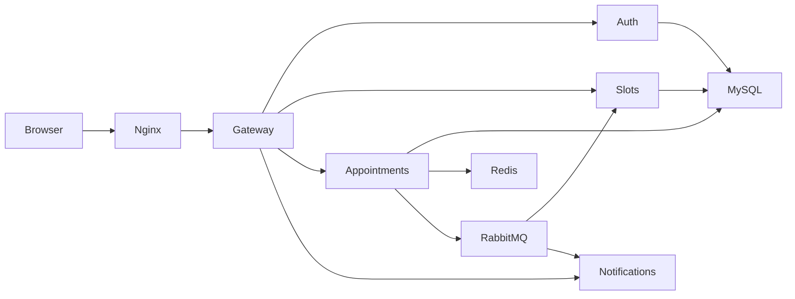
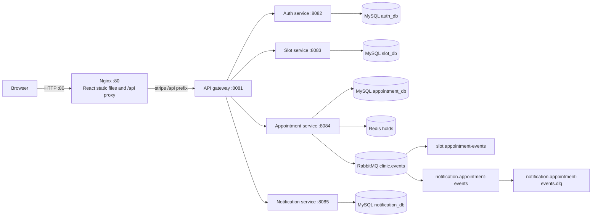
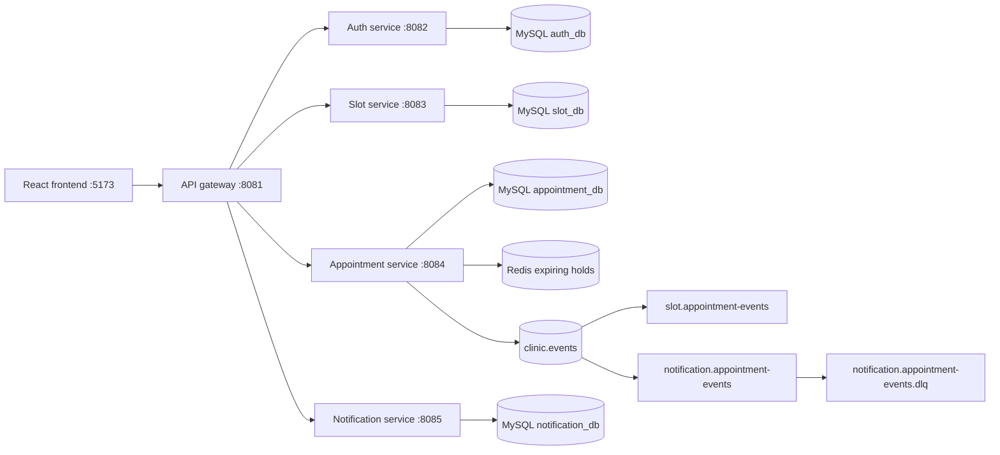

# Clinic Booking Platform

An appointment platform built with Java 17, Spring Boot, MySQL, Redis, RabbitMQ, and React. Phase 1 supports running applications on the host with containerized infrastructure; Phase 2 provides a full Docker Compose stack with Nginx as the public entry point.

[](https://github.com/Ahsan-Dowla/ClinicFlow-Event-Driven-Clinic-Appointment-Platform/actions/workflows/ci.yml)

## Run the containerized stack

Prerequisite: Docker Desktop or Docker Engine with Docker Compose v2.

```powershell
Copy-Item .env.example .env
.\scripts\setup-env.ps1
docker compose up -d --build
```

The setup script generates local secrets and seeded-account passwords; save the passwords it displays securely. The frontend is served at <http://localhost> by default.

## Architecture at a glance



## Highlights

- With 20 parallel booking attempts, 1 succeeded and the other 19 received HTTP 409.
- The notification queue retained a booking event during service downtime and delivered it after recovery.
- Docker image sizes: Frontend/Nginx 74 MB; API gateway 464 MB; Auth service 499 MB; Slot service 503 MB; Notification service 503 MB; Appointment service 521 MB.

## Ports

| Component | Port |
| --- | ---: |
| API gateway | 8081 |
| Auth service | 8082 |
| Slot service | 8083 |
| Appointment service | 8084 |
| Notification service | 8085 |
| Frontend | 5173 |
| MySQL | 3306 |
| Redis | 6379 |
| RabbitMQ | 5672 |
| RabbitMQ management UI | 15672 |

## Local setup

1. Install Java 17, Maven, Node.js, npm, and Docker Compose.
2. Copy `.env.example` to `.env`; keep the provided values for local development or change them consistently.
   In each PowerShell terminal used for an application, load those values before starting it:

   ```powershell
   Get-Content .env | Where-Object { $_ -match '^[A-Za-z_][A-Za-z0-9_]*=' } | ForEach-Object {
       $name, $value = $_ -split '=', 2
       Set-Item "Env:$name" $value
   }
   ```
3. Start the infrastructure:

   ```powershell
   docker compose --env-file .env -f infra/docker-compose.infra.yml up -d
   docker compose --env-file .env -f infra/docker-compose.infra.yml ps
   ```

4. Start auth-service:

   ```powershell
   mvn -f auth-service\pom.xml spring-boot:run
   ```

5. In another terminal, start the API gateway:

   ```powershell
   mvn -f api-gateway\pom.xml spring-boot:run
   ```

6. Start slot-service in a third terminal:

   ```powershell
   mvn -f slot-service\pom.xml spring-boot:run
   ```

7. Start appointment-service in a fourth terminal:

   ```powershell
   mvn -f appointment-service\pom.xml spring-boot:run
   ```

8. Start notification-service in another terminal:

   ```powershell
   mvn -f notification-service\pom.xml spring-boot:run
   ```

9. Start the frontend:

   ```powershell
   npm install --prefix frontend
   npm run dev --prefix frontend
   ```

10. Open the frontend at <http://localhost:5173>. RabbitMQ management is at <http://localhost:15672>.

The **development-only** Flyway migration seeds local demo accounts; their password is for the development profile only and must not be used outside local development. Change these credentials before shared use.

Register and log in through the gateway at `http://localhost:8081/auth/register` and `http://localhost:8081/auth/login`. Protected routes require the returned bearer token.

Appointment confirmation/cancellation and reminder events use the durable `clinic.events` topic exchange. Slot and notification services declare their durable queues and bindings when they start; the notification service retries transient failures and routes messages that fail all three attempts to `notification.appointment-events.dlq`. The event envelope carries an event ID and correlation ID for tracing.

## Full Docker Compose stack

### Prerequisites and first run

Install Docker Desktop (or Docker Engine) with Docker Compose v2. Copy the example environment file, then replace the example credentials, JWT key, and initial-account BCrypt hashes with values for your environment. Use the same JWT secret for every service; the Compose stack activates the `prod` profile and does not use the development seed migration.

```powershell
Copy-Item .env.example .env
# Edit .env and replace the example secrets and BCrypt hashes.
docker compose up -d --build
docker compose ps
```

By default, the browser application is at <http://localhost> and RabbitMQ management is at <http://localhost:15672>. Only Nginx publishes the application stack; backend, MySQL, Redis, and RabbitMQ AMQP ports stay on the private Compose network. The development management UI uses the RabbitMQ credentials in `.env`.

If a host port is already in use, change `HTTP_PORT` or `RABBITMQ_MANAGEMENT_PORT` in `.env` before starting. For example, set `HTTP_PORT=8092` to use <http://localhost:8092>. The host-run Phase 1 infrastructure uses its own Compose file, containers, and volumes and is not modified by the root Compose project.

### Logs, stopping, and deleting data

```powershell
docker compose logs -f
docker compose logs -f api-gateway
docker compose stop
docker compose down
```

`docker compose down` removes the Phase 2 containers and network but keeps data volumes. To permanently delete **only the Phase 2** MySQL and RabbitMQ data as well:

```powershell
docker compose down -v --remove-orphans
```

The Phase 1 infrastructure has a separate project. Do not use its `down -v` command unless you specifically intend to erase that development database and broker data.

## Phase 2 architecture



## API summary

All browser requests use the gateway at `http://localhost:8081`.

| Method | Path | Purpose |
| --- | --- | --- |
| `POST` | `/auth/register` | Register a patient (`name`, `email`, `password`, optional `phone`) |
| `POST` | `/auth/login` | Log in and receive a bearer JWT |
| `GET` | `/auth/me` | Read the authenticated profile |
| `GET` | `/doctors` | List doctors |
| `GET` | `/doctors/{id}` | Read a doctor profile for appointment ownership checks |
| `GET` | `/doctors/{id}/slots?date=YYYY-MM-DD&status=AVAILABLE` | List a doctor's slots |
| `POST` | `/doctors/{id}/slots` | Create one slot (doctor owner or admin) |
| `POST` | `/doctors/{id}/slots/generate` | Generate slots for a day (doctor owner or admin) |
| `GET` | `/slots/{id}` | Read a slot for appointment-service lookup |
| `POST` | `/appointments/hold` | Hold a slot for five minutes (`slotId`) |
| `POST` | `/appointments/confirm` | Confirm a held slot (`slotId`) |
| `POST` | `/appointments/{id}/cancel` | Cancel the caller's confirmed appointment |
| `GET` | `/appointments/my` | List the caller's appointments |
| `GET` | `/appointments/doctor/{doctorId}` | List a doctor's appointments |
| `GET` | `/notifications/my` | List the caller's notifications |

Swagger UI is available on each service at `/swagger-ui.html`; service health and info are at `/actuator/health` and `/actuator/info`.

## Build and test

Run each independent Maven service suite from the workspace root:

```powershell
mvn -f auth-service\pom.xml test
mvn -f api-gateway\pom.xml test
mvn -f slot-service\pom.xml test
mvn -f appointment-service\pom.xml test
mvn -f notification-service\pom.xml test
npm run build --prefix frontend
npm audit --prefix frontend
```

The concurrency test and manual queue-durability proof are described in [docs/TEST_RESULTS.md](./docs/TEST_RESULTS.md).

## Reliability tests

Use `scripts/test-booking-concurrency.mjs` to verify one booking wins when 20 clients attempt the same slot. The notification-service downtime/recovery walkthrough and current validation limits are recorded in [docs/TEST_RESULTS.md](./docs/TEST_RESULTS.md).

## Architecture



The MySQL initialization script creates a separate schema for each service. To reset this development database, stop the infrastructure and remove its named volumes with `docker compose -f infra/docker-compose.infra.yml down -v`.

## Project structure

```text
auth-service/          Registration, login, and JWT
slot-service/          Doctors and bookable slots
appointment-service/   Holds, booking, cancellation, reminders
notification-service/  Durable event consumption and notifications
api-gateway/           Public routing and JWT validation
frontend/              React/Vite user interface
infra/                 Local MySQL, Redis, and RabbitMQ only
docs/                  Architecture, assumptions, learning notes, and test results
```

## Detailed documentation

- [Project guide](docs/PROJECT_GUIDE.md): setup, environment, run commands, API routes, tests, and troubleshooting.
- [Project explanation](docs/PROJECT_EXPLANATION.md): architecture, request/event flows, and design decisions.
- [Test results](docs/TEST_RESULTS.md): verification evidence and measured image sizes.
- [Learning notes](docs/LEARNING_NOTES.md): milestone notes and interview questions.
- [Assumptions](docs/ASSUMPTIONS.md): implementation assumptions and environment constraints.

## Scope

Phase 1 local development and Phase 2 containerization are implemented. GitHub setup and later phases remain out of scope.
