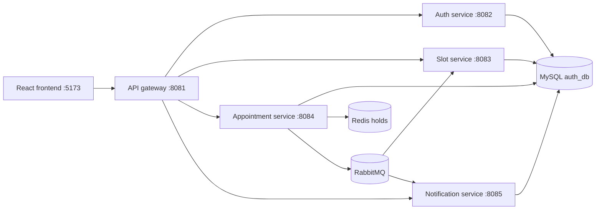

# Architecture

## Phase 1 runtime

Each service owns its schema and accesses it independently. The appointment service is the source of truth for active bookings. Redis provides expiring booking holds; a database unique constraint will enforce the final no-double-booking guarantee. RabbitMQ carries durable appointment events for slot updates and notifications.

The appointment row stores the patient's email as a booking-time snapshot so scheduled reminders can be created without depending on an auth-service lookup. Events use persistent JSON messages with event and correlation IDs. The notification consumer records mock email deliveries in its database and is idempotent by appointment and notification type.

## Local infrastructure

`infra/docker-compose.infra.yml` starts only MySQL, Redis, and RabbitMQ. Spring Boot applications and the frontend are run locally during Phase 1.

## Interview talking points

- **Double-booking prevention:** Redis `SET NX EX` provides a short-lived hold for a fast conflict response. The appointment table's unique nullable `active_slot_id` is the final durable guarantee; cancellation clears it while keeping history.
- **Eventual slot availability:** Appointment confirmation is committed before the event is published. Slot status is a read-model update from RabbitMQ and may lag briefly; appointment-service remains the booking source of truth.
- **Notification reliability:** A durable notification queue buffers events while notification-service is stopped. Consumer retries use backoff, failed deliveries go to a durable DLQ, and `(appointment_id, type)` makes processing idempotent.
- **Service boundaries:** Each service owns its schema and migrations. APIs and events replace cross-schema joins and foreign keys.
- **Authentication:** The gateway checks JWTs and forwards identity claims as headers; each service independently verifies the same signed token rather than trusting those headers as authentication.
- **Operational tracing:** The gateway adds/forwards a correlation ID. HTTP filters place it in MDC, and appointment event envelopes carry it through asynchronous consumers.
