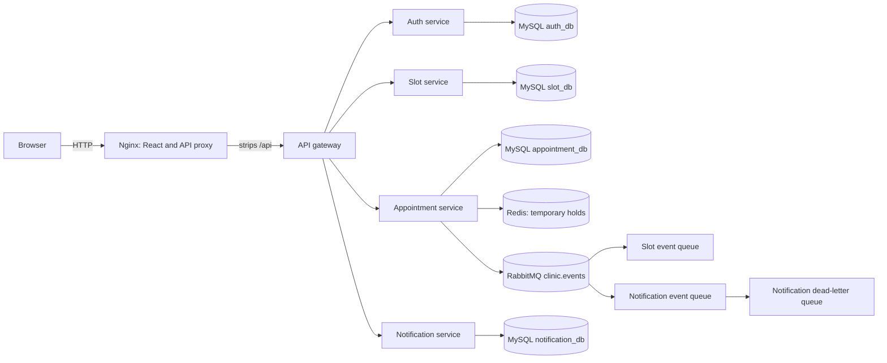

# Clinic Booking Platform — Project Explanation and Decisions

This document explains the system's architecture, request and event flows, and the reasons behind its main implementation and deployment choices. For setup commands and API operations, see [PROJECT_GUIDE.md](./PROJECT_GUIDE.md).

## 1. Project purpose

The platform supports an appointment lifecycle: doctors publish availability, patients reserve a slot temporarily, confirm an appointment, and later cancel it if needed. Authentication and role checks protect user and provider operations. Asynchronous events update slot state and deliver notifications without requiring all services to be available for the entire request path.

## 2. Logical architecture

The project is split into five Spring services and one React frontend:

| Component | Owns |
| --- | --- |
| API gateway | Public backend routing, JWT validation, and gateway CORS |
| Auth service | Registration, login, user profiles, and token issuance |
| Slot service | Doctor profiles and slot availability |
| Appointment service | Holds, confirmation/cancellation, appointment records, and reminder events |
| Notification service | Durable event consumption and user notification records |
| React frontend | User-facing browser experience |

Each backend service has its own MySQL schema. The platform also uses Redis for expiring holds and RabbitMQ for application events.

### Phase 1: local development

The React/Vite server and Spring services run as host processes. Docker Compose supplies MySQL, Redis, and RabbitMQ. This mode is useful for developing and debugging a service without rebuilding its image.

### Phase 2: containerized deployment

All components run in the root Compose project. Nginx serves the compiled React application and is the public application entry point. It proxies `/api/` requests to the gateway and removes the `/api/` prefix. Backend services, MySQL, Redis, and RabbitMQ use private network access and are not published as host ports.

## 3. Important request and event flows

### Sign-in and authorization

1. The browser sends registration or login requests to the gateway.
2. The gateway routes the request to auth-service.
3. Auth-service verifies credentials and returns a JWT on login.
4. The browser sends that token as a bearer token on protected API requests.
5. The gateway and relevant downstream services validate the token using the shared signing secret; role checks limit administrative and doctor operations.

Using one shared JWT key is an explicit requirement for interoperable token validation. The key is supplied through environment configuration and must not be baked into the application image or committed config.

### Booking and cancellation

1. A patient requests a temporary hold for an available slot.
2. Appointment-service uses Redis for the short-lived hold and records the appointment workflow.
3. The patient confirms the held slot. Availability checks and state changes must prevent two simultaneous requests from booking the same slot.
4. Appointment events are published to RabbitMQ.
5. Slot-service consumes relevant events and updates availability; notification-service consumes events and persists user notifications.
6. Cancellation changes the appointment and releases the slot, then emits an event for downstream updates and notification.

The hold duration is five minutes. The concurrency proof sent 20 parallel contenders to the same fresh slot: exactly one hold and confirmation succeeded and 19 contenders received HTTP 409.

### Notification delivery and recovery

Appointment and reminder events use the durable `clinic.events` topic exchange. Slot and notification services declare their durable queues and bindings. Notification-service retries transient processing failures and routes messages that fail all three attempts to `notification.appointment-events.dlq`. Event envelopes include event and correlation IDs for tracing.

The verified recovery test stopped notification-service while a booking was made. RabbitMQ held one ready message (`ready=1`, `unacked=0`); after the consumer restarted, the notification persisted as `SENT` and the queue drained (`ready=0`). This demonstrates decoupled delivery across a consumer outage.

## 4. Why these technologies and patterns

### Service boundaries

Separating authentication, scheduling, appointments, and notifications gives each area a focused responsibility and a separate schema. The gateway gives browser clients one stable API entry point while internal services remain private in the containerized deployment.

### MySQL schemas per service

Each service owns its schema rather than sharing tables with other services. This keeps persistence boundaries visible and lets each service migrate its own data with Flyway. The Compose MySQL initialization creates `auth_db`, `slot_db`, `appointment_db`, and `notification_db`.

### Redis for expiring holds

A temporary hold is time-bounded and benefits from a fast store with expiry semantics. Redis is used for this transient reservation state rather than keeping abandoned holds indefinitely in the relational database.

### RabbitMQ for domain events

Notifications and slot updates should not make appointment confirmation depend on synchronous calls to every consumer. A durable broker queue buffers messages during consumer downtime and allows consumers to retry. A dead-letter queue provides a place to inspect events that repeatedly fail.

### Nginx as the sole public Compose entry

The browser uses one origin for static files and APIs. Nginx serves the static React build, applies the SPA fallback, compresses responses, caches fingerprinted assets, and forwards `/api/` to the gateway. The trailing slash on the proxy target strips `/api`, preserving the existing gateway route paths. This avoids publishing each backend port and avoids requiring the browser to resolve internal Docker names.

### Docker DNS and health-conditioned startup

Compose service names such as `mysql`, `redis`, `rabbitmq`, and `auth-service` resolve through Docker DNS on the private bridge network. Container `localhost` refers to that container only, so internal connection URLs use service names, not `localhost`.

The Compose dependencies use `condition: service_healthy`. Plain `depends_on` controls startup order but does not mean a dependency is ready to accept requests. Healthchecks give Compose a readiness condition before dependents start.

### Multi-stage images and non-root services

Spring image builds use a Maven/JDK build stage and a smaller Java runtime stage. Dependencies are resolved before application source is copied to improve build-layer caching. The Spring Boot `repackage` goal is used because the services do not inherit the Spring Boot parent POM and otherwise would not produce an executable Boot JAR. Backend containers run as a non-root user and use container-aware JVM sizing.

The frontend is built in a Node stage and served by Nginx in the final stage. This keeps Node and development dependencies out of the web runtime image. Curl is installed in backend runtime images because their Docker healthchecks call Actuator.

## 5. Configuration and secret handling

- Environment variables externalize service ports, database/cache/broker settings, downstream service URLs, JWT settings, and gateway CORS.
- `.env.example` contains safe example placeholders; developers copy it to the ignored `.env` and replace the placeholders.
- The Compose app services receive a dedicated MySQL application user, not the MySQL root password.
- A single strong JWT secret must be shared by the gateway and services that validate tokens.
- The full Compose stack activates the `prod` profile and seeds initial accounts from environment-provided BCrypt hashes.
- A dev-only Flyway migration contains a seed hash for the local demo password `password`. It is not appropriate for shared or production environments.
- Dockerfiles and Compose configuration must not contain literal deployment secrets. Avoid printing `.env` or container environment values in diagnostic output.

## 6. Isolation between Phase 1 and Phase 2

The existing `infra/docker-compose.infra.yml` remains the Phase 1 infrastructure entry point. The root Compose file starts the complete Phase 2 stack under a distinct project/network with dedicated MySQL and RabbitMQ named volumes. This allows both modes to coexist without reusing container or volume names. Only Phase 2 resources should be removed with the root project's `docker compose down -v`.

## 7. Host-specific validation limitations

Compose defaults remain Nginx host port 80 and RabbitMQ management host port 15672. In the verified Windows environment:

- IIS owns port 80.
- The Phase 1 RabbitMQ container owns port 15672.
- Port 8091 was also occupied during testing.

The Phase 2 stack was therefore validated at Nginx port 8092 and management port 15673. No IIS or Phase 1 infrastructure was stopped or deleted. On a clean machine, the requested defaults can be used; otherwise set `HTTP_PORT` and `RABBITMQ_MANAGEMENT_PORT` in `.env`.

## 8. Verification evidence

The recorded Phase 2 verification includes:

- All five Maven suites and the frontend production build passed during configuration externalization.
- All nine full-stack Compose containers became healthy.
- Registration/login worked through Nginx; unauthenticated protected routes returned HTTP 401 as expected.
- Booking and cancellation updated slot status and persisted notifications.
- A 20-contender booking test produced exactly one successful hold/confirmation.
- Notification-service downtime left the event queued; after restart, delivery succeeded and the queue drained.
- The clean build-and-start command completed in 217.5 seconds; image sizes are listed in [TEST_RESULTS.md](./TEST_RESULTS.md).

See [LEARNING_NOTES.md](./LEARNING_NOTES.md) for milestone-specific interview questions and [ASSUMPTIONS.md](./ASSUMPTIONS.md) for recorded assumptions.
